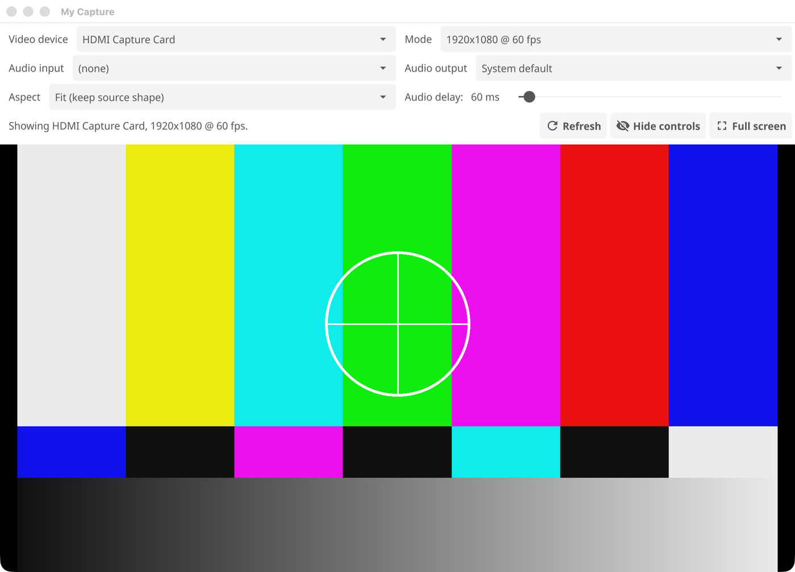

# my-capture

A small program that shows the picture and plays the sound of a USB video
capture device. It targets macOS, Windows and iPadOS.

- Pick the video device, its mode (resolution and frame rate), the audio input
  and the audio output in the window. Video starts as soon as a device is picked.
- The audio output can be any playback device the computer has, including
  Bluetooth headphones.
- The window can be resized, moved between monitors and made full screen.
- Nothing is recorded, and there is no volume control. Use the external device
  and the computer's own volume control.



## Requirements

| What | Why |
|---|---|
| Go 1.26 or later | Building |
| A C compiler | Fyne and miniaudio use cgo. macOS: `xcode-select --install`. Windows: a MinGW-w64 gcc, for example from MSYS2 |
| make | Runs the build targets below. macOS has it; on Windows use the one from MSYS2 |
| ffmpeg 5.1 or later | Captures the video. **The downloads already include it**, so users install nothing. You only need your own copy to run from source (`go run`, an IDE): macOS `brew install ffmpeg`, Windows `winget install Gyan.FFmpeg` |
| nasm | Only to build the release artefacts, for the ffmpeg that is bundled. macOS: `brew install nasm`. Windows (MSYS2): `pacman -S mingw-w64-x86_64-nasm` |
| MinGW-w64 (only to build the Windows artefact on a Mac) | The Windows C compiler. macOS: `brew install mingw-w64` |

On macOS, allow camera and microphone access when asked. If the program is
started from a terminal, the permissions are granted to the terminal.

## Build and run

The `Makefile` is the way to build, test and package. `make help` lists every
target and variable.

```sh
make build    # build bin/my-capture for this computer
make run      # build, then start it
```

Without make, `go build -o bin/my-capture .` does the same as `make build`. On
Windows add `-ldflags "-H=windowsgui"` so no console window appears.

### Make targets

| Target | What it does |
|---|---|
| `make build` | Builds `bin/my-capture` for this computer |
| `make run` | Builds, then starts the program |
| `make fmt` | Formats all Go code with gofmt |
| `make fmt-check` | Fails if any Go file is not formatted, and changes nothing |
| `make vet` | Runs `go vet` |
| `make tidy` | Runs `go mod tidy` |
| `make icons` | Redraws the application icon and rebuilds the macOS and Windows icon files from it. Only needed after changing the design. Must run on a Mac |
| `make test` | Runs the unit tests (`go test ./...`) |
| `make test-race` | Runs the unit tests with the race detector |
| `make test-e2e` | Runs the end-to-end tests in `tests/e2e` (build tag `e2e`), which need a real capture device. Does nothing if that directory does not exist |
| `make check` | `fmt-check`, `vet` and `test` together. Run it before a release |
| `make dist-macos` | Builds `dist/my-capture-VERSION-macos-universal.zip`, holding a universal (Apple silicon and Intel) `My Capture.app`. Must run on a Mac |
| `make dist-windows` | Builds `dist/my-capture-VERSION-windows-amd64.zip`, holding `my-capture.exe` and this README. Needs MinGW-w64 |
| `make dist` | Both of the above. Needs a Mac with MinGW-w64 installed |
| `make ffmpeg-macos` | Builds only the universal macOS ffmpeg that goes in the app bundle. It is built from source, takes a few minutes the first time, and is reused afterwards |
| `make ffmpeg-windows` | The same for the Windows `ffmpeg.exe`. Needs MinGW-w64 |
| `make clean` | Deletes `bin/` and `dist/` |
| `make clean-ffmpeg` | Deletes the built ffmpeg (`build/`), so it is built again next time. Needed after editing `packaging/ffmpeg/build.sh` |

### Make variables

Set them on the command line, for example `make dist-macos VERSION=1.2.0`, or
as environment variables.

| Variable | Meaning | Default |
|---|---|---|
| `VERSION` | Names the artefacts, is the version inside the macOS bundle, and is what `my-capture -version` prints | The nearest git tag or commit, else `dev` |
| `BUNDLE_FFMPEG` | `1` puts a small LGPL ffmpeg, built from source, in the macOS bundle and the Windows zip. Any other value leaves it out, for a faster local build | `1` |
| `FFMPEG_BIN` | Path of an ffmpeg executable to copy into the macOS bundle instead of the one built here. Check that its licence allows redistribution | empty (use the built one) |
| `FFMPEG_EXE` | Path of `ffmpeg.exe` to copy into the Windows zip instead of the built one. The same licence advice applies | empty (use the built one) |
| `MACOS_ARCHS` | Architectures in the macOS binary. `arm64` alone builds faster but only runs on Apple silicon | `arm64 amd64` |
| `MACOS_MIN` | Oldest macOS version supported | `12.0` |
| `SIGN_IDENTITY` | Code signing identity for the macOS bundle. `-` is an ad-hoc signature. A Developer ID such as `Developer ID Application: Name (TEAMID)` signs with the hardened runtime and the entitlements in `packaging/macos`. Notarization is not done | `-` |
| `MINGW_CC` | Windows C compiler used when building on macOS or Linux | `x86_64-w64-mingw32-gcc` |
| `GO` | The Go command | `go` |

### Release artefacts

The program uses cgo, so an artefact has to be built with a C compiler for its
own platform. `make dist-macos` therefore runs only on a Mac. `make
dist-windows` cross-compiles with MinGW-w64 from a Mac or Linux machine, or
builds natively when run under MSYS2 on Windows.

- **macOS**: the zip holds `My Capture.app`. The Info.plist in
  `assets/macos` carries the camera and microphone usage descriptions that
  macOS requires before it will allow capture. The bundle is ad-hoc signed and
  not notarized, so macOS warns that it can not check the app the first time
  it is opened from a download. The user opens System Settings, Privacy &
  Security, and clicks **Open Anyway** (on macOS 14 and earlier, right click
  the app and choose Open instead). Running `xattr -cr "My Capture.app"` also
  removes the warning. To avoid it for everyone, sign with a Developer ID using
  `SIGN_IDENTITY` and notarize the result yourself; that needs a paid Apple
  Developer account.
- **Windows**: the zip holds `my-capture.exe` built as a GUI program, with no
  console window. It is not code signed, so Windows SmartScreen shows "Windows
  protected your PC" the first time: the user clicks **More info**, then **Run
  anyway**. There is no installer; the user unzips the folder and runs the
  program. The Windows build has not been run on real Windows hardware.
- **ffmpeg**: both downloads contain their own ffmpeg, so there is nothing to
  install. See "Bundled ffmpeg" below.

### Bundled ffmpeg

`packaging/ffmpeg/build.sh` downloads the FFmpeg source release named in the
script, checks its SHA-256 checksum, and builds a small ffmpeg with only the
parts My Capture uses: the capture device (AVFoundation or DirectShow), the
raw, MJPEG and H.264 decoders, colour conversion, and the raw output. It is
about 8 MB, uses no external libraries, and on Windows needs no DLLs.

- **Licence.** The build uses no GPL or non-free code, so it is under the
  LGPL 2.1 or later, which is easy to meet when redistributing. Each download
  contains `ffmpeg-licenses` with the licence text and `FFMPEG-NOTICE.txt`,
  which gives the exact source link and says how the copy was built. The script
  is the build recipe and is in this repository.
- **Why not a ready-made build.** Most macOS builds are GPL licensed and
  contain far more than is needed (50 to 100 MB), and Homebrew's copy depends
  on many libraries elsewhere on the disk.
- **Upgrading.** Change `FFMPEG_VERSION` and `FFMPEG_SHA256` in the script,
  then `make clean-ffmpeg dist-macos` and try it with a real device.
- **Speed.** The release workflow keeps the built ffmpeg in the GitHub Actions
  cache and rebuilds it only when the script changes.
- **Replacing it.** My Capture uses the ffmpeg next to it first, then
  `MYCAPTURE_FFMPEG`, the `PATH`, and the usual install folders, so a user can
  put another build next to the program to override the bundled one.

Building never commits, tags or publishes anything. Set `VERSION` or tag the
repository yourself to name a release.

### The application icon

The icon (a screen with a camera lens on a blue tile) is drawn in code by
`tools/genicon`, so it can be changed by editing a few constants, and every size
is rendered directly rather than scaled. `make icons` regenerates and converts
it; the results are committed, so a normal build needs nothing extra.

| File | Used for |
|---|---|
| `assets/icon/icon.icns` | The macOS app bundle (`Contents/Resources`, named in `Info.plist`) |
| `assets/icon/icon.ico` and `rsrc_windows_amd64.syso` | The Windows executable. The `.syso` is a resource object that Go links in automatically when building for 64-bit Windows, which gives `my-capture.exe` its Explorer and task bar icon |
| `assets/icon/icon.png`, `icon-mac.png` | Compiled into the program (package `assets`). The window icon on Windows, and the Dock icon on macOS when the program runs outside an app bundle |

The name in the macOS menu bar and under the Dock icon ("My Capture") comes from
the app bundle. A program started without a bundle, for example from a terminal
or an IDE, would be labelled with its executable's file name (an IDE may call it
`___1App`), and the Dock can not be told otherwise afterwards. So
`internal/ui/platform_darwin.go` restarts the program once inside a temporary
`My Capture.app` in the user cache folder, built from the same `Info.plist` and
icon as the release bundle. The process keeps its process ID, so an IDE's Stop
button still works. This is skipped when already in a bundle, when
`MYCAPTURE_NO_RELAUNCH` is set, and under a debugger (a debugger loses a process
that restarts itself); in that case the menu bar and Dock icon are still right,
but the Dock tooltip shows the file name.

### Releasing

Releases are published to GitHub Releases by the **Release** workflow in
`.github/workflows/release.yml`. It runs by itself **every time something is
pushed to `master`**, and it can also be started by hand.

**Automatic.** Each push to `master` publishes a new release with the minor
number increased by one (v0.1.0, v0.2.0, v0.3.0, and so on). A run takes about
15 minutes. Pull requests and other branches never release. To push to
`master` without releasing, put `[skip ci]` in the commit message.

**By hand**, to raise the patch or major number, or to make a draft to review
before publishing:

1. Open the repository on GitHub, then **Actions**, **Release**, **Run
   workflow**, or run `gh workflow run release.yml -f bump=patch`.
2. Choose what to increase and whether to publish straight away:

   | Input | Meaning | Default |
   |---|---|---|
   | `bump` | `minor` takes v0.3.1 to v0.4.0, `patch` takes it to v0.3.2, `major` to v1.0.0 | `minor` |
   | `draft` | Create the release as a draft, to review and publish by hand. Drafts do not appear on the repository's main page until published | off |

The workflow then:

- finds the highest existing `vMAJOR.MINOR.PATCH` tag and works out the next
  one (the first release is `v0.1.0`; tags such as `v1.0.0-rc1` are ignored);
- runs `make check` and builds the macOS app on a macOS runner and the Windows
  executable on a Windows runner, both named after the new version;
- creates the git tag at the commit the workflow ran on, and the release;
- attaches `my-capture-VERSION-macos-universal.zip`,
  `my-capture-VERSION-windows-amd64.zip` and `SHA256SUMS.txt`;
- writes the release notes: a download and install header followed by
  GitHub's generated list of merged pull requests and contributors;
- records a build provenance attestation for each zip, which ties the file to
  the workflow run that built it.

The generated notes group pull requests by label, as set in
`.github/release.yml`: `enhancement` or `feature` for new features, `bug` or
`fix` for bug fixes, `documentation` for documentation, and anything else under
other changes. A pull request labelled `skip-release-notes` is left out.

To check a download:

```sh
sha256sum -c SHA256SUMS.txt                                   # on macOS: shasum -a 256 -c SHA256SUMS.txt
gh attestation verify my-capture-VERSION-macos-universal.zip --repo steveohara/my-capture
```

Each build also contains its version: `my-capture -version` prints it.

Attestations need a public repository (or a paid GitHub plan). If they are
unavailable that one step fails but the release still goes ahead, and the
`gh attestation verify` check will not work for that release.

## Usage

```
my-capture [flags]

Flags:
  -list-devices
        print the video devices, audio inputs and audio outputs, then exit
  -version
        print the version and exit
```

`my-capture -help` prints the same information as this README.

### Window controls

| Control | Action |
|---|---|
| Video device | Starts showing the device. `(none)` stops the picture |
| Mode | Resolution and frame rate. The widest mode up to 1920 pixels (normally 1920x1080) is chosen first. `Device default` lets the device decide |
| Audio input | The sound source, usually named like the capture device. It is chosen automatically when the name matches the video device. `(none)` stops the sound |
| Audio output | Where the sound is played. `System default` follows the operating system's choice |
| Aspect | How the picture fills the window. `Fit` keeps the source shape and leaves black bars. `Stretch to window` fills the whole area and distorts the shape. `Fill window` keeps the shape and crops the edges. `16:9`, `16:10`, `4:3`, `21:9` and `1:1` force that shape, then fit it in the window. Use this when the picture is the wrong shape or should fill the width |
| Audio delay | Delays the sound so it lines up with the picture. Raise it if the sound arrives first |
| Refresh | Looks for devices straight away. The lists also update by themselves every few seconds |
| Hide controls | Hides the controls strip so the picture fills the whole window. Bring it back with View, Show Controls, or the `C` key |
| Full screen | Full screen on the monitor the window is on |

### Menus, help and About

The window has the platform's own menu bar: at the top of the screen on macOS,
and inside the window on Windows.

| Menu | Items |
|---|---|
| File | Refresh Devices (`Cmd+R` / `Ctrl+R`), Quit |
| View | Full Screen (`Cmd+F` / `Ctrl+F`), Hide Controls or Show Controls (`Cmd+Shift+C` / `Ctrl+Shift+C`), Aspect (a submenu with the current mode ticked), Next Aspect |
| Help | My Capture Help, My Capture on GitHub (opens the project's main page), Report an Issue (opens the GitHub issue page), About |

On macOS, About is in the application menu, as usual for Mac applications. The
help is built into the program, so it is always available and matches the
version in use. **About** shows the version, a link to the project, and the
operating system, Go version and ffmpeg in use; **Copy details** puts that on
the clipboard for a bug report.

### Keyboard and mouse

| Key | Action |
|---|---|
| `Cmd+F` (macOS), `Ctrl+F` (Windows), `F`, `F11` | Enter or leave full screen |
| Double click the picture | Enter or leave full screen |
| `Escape` | Leave full screen |
| `C` | Hide or show the controls strip (windowed only; in full screen they are always hidden and come back as they were when you leave) |
| `A` | Step through the aspect modes. This is how to change them in full screen, where the controls are hidden |
| `Cmd+R` (macOS), `Ctrl+R` (Windows) | Refresh the device lists |
| `F1` | Show the help | Drag the window to another monitor first to use
that monitor. The chosen devices are remembered between runs.

### Plugging devices in and out

The device lists are checked every few seconds (audio every 2 seconds, video
every 4), so plugged-in devices appear and removed ones disappear without
pressing anything. If the device in use is removed, that part stops and the
status line says so. If it comes back, or if it was not connected when the
program started, it is chosen again automatically.

## Environment variables

| Variable | Meaning | Default |
|---|---|---|
| `MYCAPTURE_FFMPEG` | Absolute path of the ffmpeg executable used to capture video. When unset, my-capture uses the one next to its own executable (the downloads include one), then one on the `PATH`, then `/opt/homebrew/bin` and `/usr/local/bin`. | unset |
| `MYCAPTURE_AUDIO_DELAY_MS` | Initial audio delay in milliseconds, 20 to 1000. The audio is buffered for this long before it is played. Raise it if the sound arrives before the picture, or if the audio crackles. It can also be changed with the "Audio delay" slider, but slider changes are not remembered; set this variable to keep a value. | `60` |
| `MYCAPTURE_DEBUG` | Set to `1`, `true`, `yes` or `on` to print everything ffmpeg reports on its error stream. Use it to find out why a capture device will not open. | unset |
| `MYCAPTURE_NO_RELAUNCH` | macOS only. A program started from a terminal or an IDE has no application bundle, so macOS would label it with its file name in the Dock. To avoid that, my-capture restarts itself once inside a temporary `My Capture.app` in the user cache folder. Set to `1`, `true`, `yes` or `on` to turn that off. It is never done when the program is already in an app bundle, or under a debugger. | unset (restart inside a bundle) |

## Troubleshooting

- **"ffmpeg was not found"**: the downloads include ffmpeg, so this only happens if the bundled copy was deleted or when running from source. Install ffmpeg (`brew install ffmpeg`, `winget install Gyan.FFmpeg`) or set `MYCAPTURE_FFMPEG`.
- **The video does not start**: run with `MYCAPTURE_DEBUG=1` and read the
  ffmpeg messages. Try another mode, or `Device default`.
- **No devices listed**: on macOS check System Settings, Privacy & Security,
  Camera and Microphone.
- **The sound is ahead of or behind the picture**: move the Audio delay slider.
- **Crackling sound**: raise the audio delay.
- **`-list-devices`** shows what the program can see without opening the window.

## My Capture for iPad

`ios/` holds a separate, native Swift/SwiftUI app for iPadOS: iPadOS does not
allow starting another program such as ffmpeg, so the Go capture code used by
the desktop versions cannot run there. It reuses the desktop app's design
(device and mode pickers, aspect modes, an audio delay slider) but is built
and signed entirely with Apple's own tools.

### Requirements

| What | Why |
|---|---|
| A Mac with Xcode | Building and signing the app |
| [XcodeGen](https://github.com/yonaskolb/XcodeGen) (`brew install xcodegen`) | Generates the Xcode project from `ios/project.yml`, which is not kept in git |
| A free Apple ID, signed into Xcode | Lets the app be installed on your own iPad without a paid developer account |
| An iPad running iPadOS 17 or later, with a USB-C port | The capture card's video appears as an "external" camera, which iPadOS only lists from version 17 |

### Build and run

```sh
cd ios
xcodegen
open MyCapture.xcodeproj
```

In Xcode, select the `MyCapture` target, choose your own team under Signing &
Capabilities (Automatic signing), plug in the iPad, and run. The first run on
the device needs Developer Mode turned on (Settings, Privacy & Security,
Developer Mode), which iPadOS prompts for.

Because the capture card occupies the iPad's only USB-C port, a debugging
cable to the Mac often cannot be plugged in at the same time. See
[ios/DEBUGGING.md](ios/DEBUGGING.md) for debugging over Wi-Fi (no cable, once
paired) or over a USB-C hub.

Plugging a USB-C video capture card into the iPad makes it appear as a video
device the same way a webcam would; choose it from the video device menu.
Nothing is recorded, and the sound plays through whatever output is chosen
with the system output button (`AVRoutePickerView`), because iPadOS does not
let an app choose its own audio output.

### Project layout (`ios/`)

```
project.yml                    XcodeGen project description
MyCapture/MyCaptureApp.swift    entry point, creates the two controllers
MyCapture/ContentView.swift     the window: picture, control panel, banner
MyCapture/VideoController.swift AVCaptureDevice discovery and the capture session
MyCapture/AudioController.swift AVAudioEngine input, delay and output
MyCapture/PreviewView.swift     the preview layer and the system route picker
MyCapture/AspectMode.swift      the aspect modes, shared in spirit with internal/ui
MyCapture/HelpView.swift        the Help sheet
MyCapture/AboutView.swift       the About sheet
```

See [docs/architecture.md](docs/architecture.md) for how the iPad version
compares with the desktop ones.

## How it works

See [docs/architecture.md](docs/architecture.md).

## Project layout

```
main.go                 command line and entry point
assets                  the application icon files, and the package that embeds them
tools/genicon           draws the icon and writes every size and format
rsrc_windows_amd64.syso the icon as a Windows resource, linked into the exe
Makefile                build, test and release targets
assets/macos            Info.plist template for the macOS app bundle
packaging/macos         entitlements for signing the macOS app bundle
internal/config         environment variables and the help text for them
internal/video          ffmpeg device discovery and frame capture
internal/audio          miniaudio capture, playback and the ring buffer
internal/ui             the Fyne window, menus, help text (help.md) and the video widget
ios                     My Capture for iPad: a separate Swift/SwiftUI app (see above)
```
