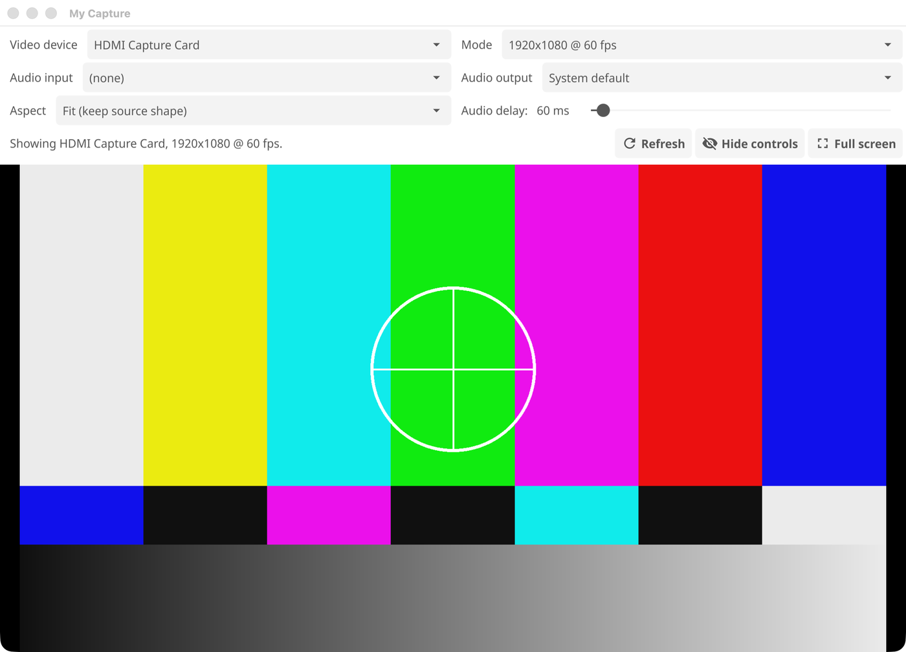
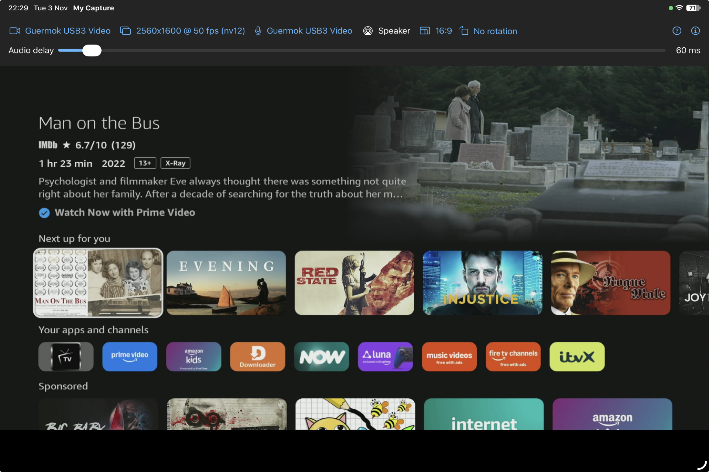

# My Capture

Shows the picture and plays the sound of a USB video capture device, on
macOS, Windows and iPadOS.

A short screen recording of the window in use, picking devices and changing
settings:

<video src="videos/demo.mp4" controls width="688"></video>

- [Project README](https://github.com/steveohara/my-capture) (source, build
  instructions, usage)
- [How it works](architecture)
- [Privacy Policy](privacy)
